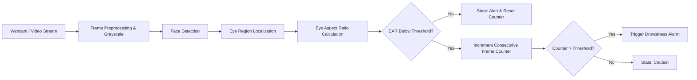

# Real-Time Driver Drowsiness Detection System

> A Computer Vision pipeline that monitors driver fatigue and alertness in real-time video streams using facial landmark tracking and Eye Aspect Ratio (EAR) metric calculation.


---

## Table of Contents
- [Overview](#overview)
- [Detection Methodology](#detection-methodology)
- [System Architecture](#system-architecture)
- [Project Structure](#project-structure)
- [Quick Start](#quick-start)
- [License](#license)

---

## Overview

Driver fatigue and microsleeps are leading causes of transportation accidents globally. This system implements a non-intrusive vision-based approach to continuously monitor the eye closure state of the driver and trigger real-time warnings whenever continuous eye closure exceeds normal blink intervals.

---

## Detection Methodology

### Eye Aspect Ratio (EAR)
For each detected eye, 6 facial landmark points are extracted. The distance between vertical landmarks is compared to the distance between horizontal landmarks using the Eye Aspect Ratio formula:

$$\text{EAR} = \frac{||\mathbf{p}_2 - \mathbf{p}_6|| + ||\mathbf{p}_3 - \mathbf{p}_5||}{2 \times ||\mathbf{p}_1 - \mathbf{p}_4||}$$

- **Open Eye:** EAR remains consistently above threshold (~0.25 to 0.35).
- **Normal Blink:** EAR drops momentarily for 1-3 frames, then recovers immediately.
- **Drowsiness / Microsleep:** EAR drops below threshold (<0.22) and persists for $N$ consecutive frames (e.g., >15 frames), triggering an alert state.

---

## System Architecture



---

## Project Structure

```
driver-drowsiness-detection/
├── app.py                      # Real-time webcam video stream detection
├── notebooks/
│   └── drowsiness_analysis.ipynb # Experimental notebook with Dlib 68-point model
├── requirements.txt            # Python dependencies
├── .gitignore
├── LICENSE
└── README.md
```

---

## Quick Start

### 1. Environment Setup

```bash
# Clone the repository
git clone https://github.com/FresherMen/driver-drowsiness-detection.git
cd driver-drowsiness-detection

# Create and activate virtual environment
python3 -m venv venv
source venv/bin/activate  # On Windows: venv\Scripts\activate

# Install dependencies
pip install -r requirements.txt
```

### 2. Run Real-Time Detection

```bash
python app.py
```

Press **Q** or **ESC** in the video window to stop monitoring.

---

## License

This project is licensed under the MIT License.
